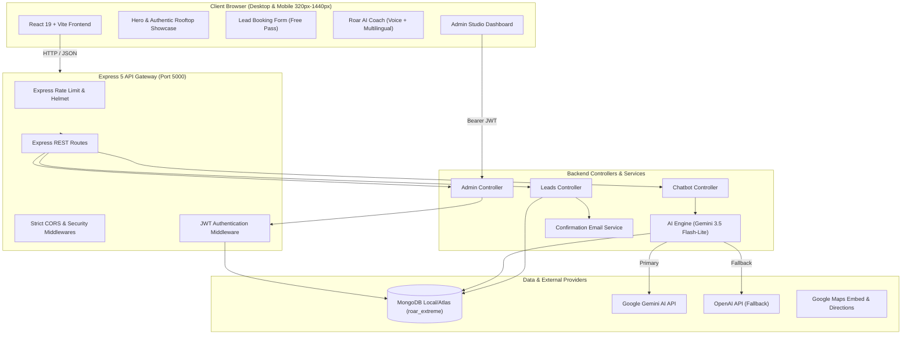

# ⚡ ROAR EXTREME — ROOFTOP PERFORMANCE STUDIO

[](https://www.typescriptlang.org/)
[](https://react.dev/)
[](https://vitejs.dev/)
[](https://tailwindcss.com/)
[](https://nodejs.org/)
[](https://www.mongodb.com/)
[](https://ai.google.dev/)

An enterprise-grade, high-performance web platform and AI-powered membership engine engineered for **ROAR EXTREME** — Nashik's premier 6th-floor rooftop fitness arena.

---

## 📑 Table of Contents

1. [Executive Summary](#-executive-summary)
2. [Key Features](#-key-features)
3. [System Architecture](#-system-architecture)
4. [Application Flows](#-application-flows)
   - [A. Visitor & Lead Conversion Flow](#a-visitor--lead-conversion-flow)
   - [B. ROAR AI Coach & Memory Engine Flow](#b-roar-ai-coach--memory-engine-flow)
   - [C. Administrative Management & Analytics Flow](#c-administrative-management--analytics-flow)
5. [Tech Stack](#-tech-stack)
6. [Repository Structure](#-repository-structure)
7. [Environment Configuration](#-environment-configuration)
8. [Installation & Local Setup](#-installation--local-setup)
9. [API Reference](#-api-reference)
10. [Testing & Quality Assurance](#-testing--quality-assurance)
11. [Deployment](#-deployment)
12. [Location & Verified Business Details](#-location--verified-business-details)

---

## 🏋️ Executive Summary

**ROAR EXTREME** is a premium fitness facility located at **601/602 Rushiraj Regency, Vidya Vikas Circle, above Axis Bank, Patil Colony, Canada Corner, Nashik**. 

This web application combines cinematic, high-energy spatial aesthetics with a full-stack booking engine, an intelligent multilingual fitness coach powered by **Google Gemini 3.5 Flash-Lite**, and a protected Administrative Control Panel with real-time conversion metrics.

---

## 🚀 Key Features

* **Cinematic Rooftop Visuals:** Anton display typography, high-contrast dark palette (`#080808`), and vibrant brand orange (`#FF5A1F`) with fluid Framer Motion animations.
* **100% Mobile Optimized:** Fluid responsive engineering tested from ultra-compact smartphones (320px) to ultra-wide 4K monitors with zero horizontal overflow.
* **Intelligent AI Coach (`Roar AI Coach`):**
  * Powered by **Google Gemini 3.5 Flash-Lite** with multi-turn conversation memory.
  * Native support for **English**, **Hindi (हिंदी)**, and **Marathi (मराठी)**.
  * Voice synthesis (Text-to-Speech) and audio recognition (Web Speech API).
  * Direct intent grounding for rooftop facility details, free trial pass inquiries, workout disciplines, and operating hours.
* **Lead Conversion Engine:**
  * Single-step free pass reservation with instant 10-digit Indian mobile validation.
  * Idempotent submission detection (prevents accidental duplicate spam while returning existing booking references).
  * Simulated instant email alerts to both client and gym management.
* **Administrative Studio Command Center:**
  * Protected JWT authentication for gym management (`admin@roarextreme.com`).
  * Live metrics: Total leads, scheduled trials, attended sessions, conversion rates, and chat engagement.
  * Interactive lead pipeline (Kanban/table lifecycle: `new` ➔ `contacted` ➔ `trial_scheduled` ➔ `attended` ➔ `converted` ➔ `archived`).
  * Real-time knowledge base management and status updates.

---

## 🏛️ System Architecture



---

## 🔄 Application Flows

### A. Visitor & Lead Conversion Flow
1. **Landing & Exploration:** Visitors land on the rooftop studio experience, reviewing facilities, equipment, coaching team, and authentic photo gallery.
2. **Action Trigger:** Visitor clicks **Claim Your Free Session** or opens the floating quick-action pass.
3. **Validation & Submission:**
   - Client validates name, 10-digit mobile number, preferred workout discipline, and schedule preference.
   - Request is POSTed to `/api/leads`.
4. **Processing & Deduplication:**
   - Backend checks MongoDB for existing pending applications by mobile number.
   - If existing, returns the existing booking reference code (`ROAR-XXXX-XXXX`) without creating duplicate records.
   - If new, stores the lead with status `new`, assigns a cryptographically unique reference code, and dispatches confirmation notifications.
5. **Confirmation Modal:** Instant visual confirmation with step-by-step instructions for arriving at the 6th-floor rooftop.

### B. ROAR AI Coach & Memory Engine Flow
1. **Initiation:** User opens the coach via bottom-right floating trigger or quick pills.
2. **Language & Preference Selection:** Supports dynamic language switching (`EN`, `HI`, `MR`) and persists user workout goals in MongoDB session state.
3. **Execution Pipeline:**
   - Backend queries verified gym facts (location, timing, coaching disciplines).
   - Gemini 3.5 Flash-Lite formats responses under strict safety guardrails (no unsupervised medical prescriptions).
   - If Gemini is unreachable or rate-limited, the system falls back seamlessly to deterministic rule-based grounded responses.
4. **Voice Interaction:** Audio output via Web Speech API allows hands-free queries during workout prep.

### C. Administrative Management & Analytics Flow
1. **Authentication:** Studio manager logs into `/admin/login` using administrative credentials.
2. **JWT Issuance:** Server validates hashed credentials, issuing an HTTP-safe signed Bearer token with 7-day expiration.
3. **Live Dashboard:** Aggregates real-time inquiries, attendance status, and 14-day booking volume charts powered by Recharts.
4. **Lead Pipeline Operations:** Admins update trial attendance status, mark phone follow-ups, and archive inactive records with instant live state synchronisation.

---

## 🛠️ Tech Stack

### Frontend
* **Core:** React 19, TypeScript 5.9, Vite 8
* **Styling:** Tailwind CSS 4, CSS Variables, Glassmorphism
* **Animations:** Framer Motion
* **Icons & Visuals:** Lucide React, Recharts
* **Audio & Speech:** Web Speech API (Synthesis & Recognition)

### Backend
* **Runtime:** Node.js (v20+ recommended), Express 5
* **Database & ODM:** MongoDB, Mongoose 9
* **Authentication:** JSON Web Tokens (`jsonwebtoken`), `bcryptjs`
* **Validation:** Zod Schema Validation
* **Security & Resilience:** Helmet, Express Rate Limit, CORS, Winston Logger

### AI & Integrations
* **Primary AI Engine:** Google Gemini (`gemini-3.5-flash-lite`) via official REST endpoints
* **Fallback AI:** OpenAI (`gpt-4o-mini`)
* **Mapping:** Google Maps Embed API & Place ID `0x3bddeb99f3d80043:0xe11b269b99a6d07e`

---

## 📁 Repository Structure

```
roar-fitness/
├── backend/                         # Express Backend Server
│   ├── src/
│   │   ├── ai/                      # AI Prompts, Knowledge Seed & Tool Handlers
│   │   │   ├── systemPrompt.js      # System guardrails & gym guidelines
│   │   │   └── toolExecutor.js      # Grounded knowledge retrievers
│   │   ├── controllers/             # REST Route Controllers
│   │   │   ├── adminController.js   # Analytics & lead lifecycle
│   │   │   ├── authController.js    # JWT admin authentication
│   │   │   ├── chatbotController.js # Multi-turn conversational endpoint
│   │   │   └── leadsController.js   # Free pass reservation & validation
│   │   ├── middleware/              # Auth, validation & rate limiting
│   │   ├── models/                  # Mongoose Schemas (Admin, Lead, Chat, Memory)
│   │   ├── routes/                  # API Endpoint Declarations
│   │   ├── services/                # Gemini AI Service & Email Dispatcher
│   │   ├── templates/               # Responsive HTML Email Templates
│   │   └── server.js                # Express App Initialization & Listeners
│   ├── tests/                       # Vitest Backend Test Suite (13 tests)
│   ├── .env.example                 # Backend environment variable template
│   └── package.json
├── src/                             # React 19 Frontend
│   ├── assets/                      # Studio images, authentic photos & logos
│   │   └── roar/branding/           # Official ROAR EXTREME logo
│   ├── components/                  # Shared UI Components
│   │   ├── Chatbot/                 # Roar AI Coach widget (mobile sheet / desktop)
│   │   ├── Navbar/                  # Responsive header with mobile drawer
│   │   ├── Footer/                  # Business info, hours, map link
│   │   └── SectionHeading/          # Typography headers
│   ├── config/                      # Verified business information
│   │   └── business.ts              # Single source of truth for location & contact
│   ├── pages/                       # Application Pages
│   │   ├── Home/                    # Main landing page
│   │   ├── Register/                # Free session application
│   │   ├── Training/                # Workout disciplines & curriculum
│   │   └── Admin/                   # Studio Admin Dashboard & Lead Management
│   ├── sections/                    # Modular Landing Sections
│   │   ├── Hero/                    # High-impact rooftop opening
│   │   ├── About/                   # Facility heritage & ethos
│   │   ├── Disciplines/             # Boxing, functional, strength, cardio
│   │   ├── Gallery/                 # Authentic studio gallery
│   │   └── Location/                # Interactive Google Maps & rooftop directions
│   ├── App.tsx                      # Root component & route definitions
│   └── main.tsx                     # React DOM bootstrap
├── scripts/                         # Mobile QA & Playwright Automation Scripts
├── package.json                     # Frontend & root npm scripts
├── tsconfig.json                    # TypeScript Configuration
└── vite.config.ts                   # Vite Configuration & Proxy Setup
```

---

## ⚙️ Environment Configuration

### Backend Configuration (`backend/.env`)

Copy the template from `backend/.env.example` to `backend/.env`:

```bash
cp backend/.env.example backend/.env
```

Configure the following variables:

```ini
PORT=5000
NODE_ENV=development

# MongoDB Connection String (Local or MongoDB Atlas)
MONGO_URI=mongodb://127.0.0.1:27017/roar_extreme

# Frontend Client URL for CORS
CLIENT_URL=http://localhost:5173

# JWT Authentication
JWT_SECRET=your_super_secure_random_jwt_secret_key_at_least_32_chars
JWT_EXPIRES_IN=7d

# AI Engine Configuration
AI_PROVIDER=gemini
GEMINI_API_KEY=your_google_gemini_api_key
GEMINI_MODEL=gemini-3.5-flash-lite

# (Optional) OpenAI Fallback
OPENAI_API_KEY=your_openai_api_key
AI_MODEL=gemini-3.5-flash-lite

# Notification Settings
RESEND_API_KEY=your_resend_api_key_or_leave_empty_for_mock
FROM_EMAIL=noreply@roarextreme.com
GYM_NOTIFICATION_EMAIL=admin@roarextreme.com

# Chatbot Session Retention
MEMORY_ENABLED=true
CHAT_HISTORY_RETENTION_DAYS=30
MEMORY_RETENTION_DAYS=180
```

---

## 💻 Installation & Local Setup

### 1. Prerequisites
* **Node.js:** v20.x or higher
* **npm:** v10.x or higher
* **MongoDB:** Local community service running on port 27017 or a free MongoDB Atlas URI

### 2. Clone Repository
```bash
git clone https://github.com/gary-production-ft/roar_extreme.git
cd roar_extreme
```

### 3. Install Dependencies
```bash
# Install frontend dependencies
npm install

# Install backend dependencies
cd backend
npm install
cd ..
```

### 4. Seed Database (Initial Admin & Knowledge Base)
To create the default administrator account and seed gym facts:
```bash
cd backend
npm run seed
cd ..
```
* **Default Admin Email:** `admin@roarextreme.com`
* **Default Admin Password:** `RoarAdmin#2026`

### 5. Start Development Servers

You can run both servers concurrently or in separate terminals:

**Terminal 1 — Backend API (Port 5000):**
```bash
npm run server
```

**Terminal 2 — Frontend App (Port 5173):**
```bash
npm run dev
```

Visit `http://localhost:5173` in your browser.

---

## 📡 API Reference

### Public Endpoints

| Method | Endpoint | Description |
|---|---|---|
| `GET` | `/health` | Server health & uptime status check |
| `POST` | `/api/leads` | Submit a free trial session reservation |
| `POST` | `/api/chat` | Send message to Roar AI Coach (multilingual) |
| `POST` | `/api/preferences` | Store user workout preference / goal |
| `DELETE`| `/api/preferences/:id`| Clear session memory (GDPR compliance) |

### Administrative Endpoints (`Authorization: Bearer <JWT>`)

| Method | Endpoint | Description |
|---|---|---|
| `POST` | `/api/auth/login` | Authenticate admin credentials and receive JWT |
| `GET` | `/api/admin/metrics` | Retrieve live dashboard statistics & 14-day chart |
| `GET` | `/api/admin/leads` | Paginated and filtered lead database |
| `PATCH`| `/api/admin/leads/:id` | Update lead status (`attended`, `converted`, etc.) |
| `GET` | `/api/admin/knowledge` | Retrieve gym knowledge base documents |

---

## 🧪 Testing & Quality Assurance

### Run Backend Vitest Suite
```bash
npm run backend:test
```
Includes **13 unit and integration tests** covering:
* Input validation (10-digit phone regex, discipline choices)
* Idempotent lead deduplication
* Admin authentication and protected routes
* Chatbot fallback and preference persistence

### Run Production Build & TypeScript Verification
```bash
npm run build
```
Executes `tsc -b` for strict type checking followed by Vite production bundling with asset optimization.

### Run Mobile Viewport Automation QA
```bash
node scripts/mobileQa.js
```
Automated Playwright test checking:
* Responsive layouts across 320px, 360px, 375px, 390px, 412px, 430px, 768px, and 1280px.
* Zero horizontal overflow (`scrollWidth <= clientWidth`).
* Chatbot opening, message scrolling, and mobile close button responsiveness.

---

## 📍 Location & Verified Business Details

* **Studio Name:** ROAR EXTREME (Roar Fitness)
* **Verified Address:** `601/602 Rushiraj Regency, Vidya Vikas Circle, above Axis Bank, Patil Colony, Canada Corner, Nashik, Maharashtra 422005`
* **Arrival Note:** Take elevator to 5th floor, then take the dedicated staircase to the 6th floor rooftop arena.
* **Operating Hours:** Monday – Saturday: `6:00 AM – 10:00 PM` (Sunday: Recovery by appointment)
* **Google Maps Navigation:** [Get Directions to Roar Fitness](https://www.google.com/maps/dir//Roar+Fitness,+601%2F602+Rushiraj+Regency,+Vidya+Vikas+Cir,+above+Axis+Bank,+Patil+Colony,+Canada+Corner,+Nashik,+Maharashtra+422005/@19.9890244,73.7830858,24934m/data=!3m1!1e3!4m8!4m7!1m0!1m5!1m1!1s0x3bddeb99f3d80043:0xe11b269b99a6d07e!2m2!1d73.7656344!2d20.0094151)

---

## 🛡️ License

Private and proprietary project for **ROAR EXTREME Nashik**. All rights reserved.
