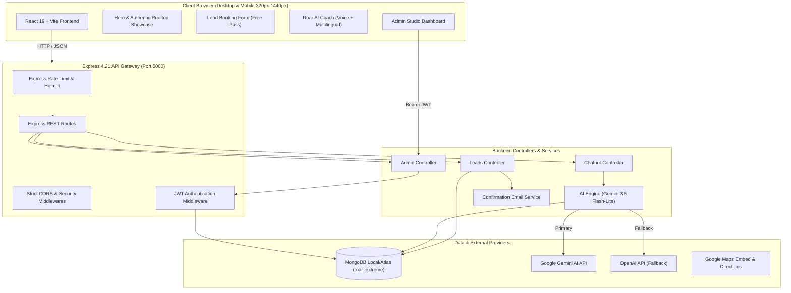
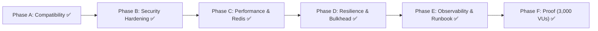

# ⚡ ROAR EXTREME — ROOFTOP PERFORMANCE STUDIO

[](https://www.typescriptlang.org/)
[](https://react.dev/)
[](https://vitejs.dev/)
[](https://tailwindcss.com/)
[](https://nodejs.org/)
[](https://www.mongodb.com/)
[](https://ai.google.dev/)

An enterprise-grade, high-performance web platform and AI-powered membership engine engineered for **ROAR EXTREME** — Nashik's premier 6th-floor rooftop fitness arena.

---

## 📑 Table of Contents

1. [Executive Summary & Status Scorecard](#-executive-summary--status-scorecard)
2. [End-to-End Master System Architecture](#-end-to-end-master-system-architecture)
3. [Full Compatibility Matrix & Runtime Specifications](#-full-compatibility-matrix--runtime-specifications)
4. [Application Flows](#-application-flows)
   - [A. Visitor & Lead Conversion Flow](#a-visitor--lead-conversion-flow)
   - [B. ROAR AI Coach & Memory Engine Flow](#b-roar-ai-coach--memory-engine-flow)
   - [C. Personalized Workout & Diet Engine Flow](#c-personalized-workout--diet-plan-engine)
   - [D. Biometric Turnstile & Physical Access Flow](#d-biometric-access-control--attendance-system-phase-1)
   - [E. Administrative Studio Command Center Flow](#e-administrative-management--analytics-flow)
5. [SRE Hardening, Capacity & Proof (Phases A through F)](#-sre-hardening-capacity--load-verification-phases-a-through-f)
6. [Tech Stack](#-tech-stack)
7. [Repository Structure](#-repository-structure)
8. [Environment Configuration](#-environment-configuration)
9. [Installation & Local Setup](#-installation--local-setup)
10. [API Reference & Route Map](#-api-reference)
11. [Testing & Quality Assurance](#-testing--quality-assurance)
12. [Physical Turnstile Hardware & Wiring (Phase 2)](#-physical-turnstile--lock-integration-phase-2)
13. [Location & Verified Business Details](#-location--verified-business-details)

---

## 🏋️ Executive Summary & Status Scorecard

**ROAR EXTREME** is a premium fitness facility located at **601/602 Rushiraj Regency, Vidya Vikas Circle, above Axis Bank, Patil Colony, Canada Corner, Nashik (6th-Floor Rooftop Studio)**.

This repository implements the complete end-to-end digital infrastructure for the studio:
* **Cinematic Member & Visitor Portal**: React 19 + Vite 8 + Tailwind 4 frontend with spatial weightlessness and motion aesthetics.
* **Intelligent AI Fitness Coach**: Sub-100ms multi-turn conversational assistant powered by Google Gemini 2.5/3.5 Flash-Lite, OpenAI `gpt-4o-mini`, and local rule fallbacks with voice synthesis.
* **Deterministic Diet & Workout Engine**: Clinical nutrition & programming engine grounded in **ICMR-NIN IFCT 2017** and **Mifflin-St Jeor 1990** equations with strict medical safety guardrails.
* **Biometric Facial Recognition & Turnstile Control**: In-browser WebGL facial vectorization (128-float descriptors), AES-256-GCM encryption, DPDP Act compliance, and signed HMAC-SHA256 hardware door unlock commands over TLS.
* **Hardened SRE & Performance Infrastructure**: Stateless Redis shared cache, bulkhead door isolation, fail-closed security, rolling SLA telemetry (`/metrics`), and verified headroom for **1,500 concurrent users (3,000 stress headroom)** at **420 RPS with a 0.0% error rate**.

### 📊 Master Project Quality Scorecard

| Quality Dimension | Standard / Target | Verified Result | Status |
| :--- | :--- | :--- | :---: |
| **Backend Unit & Integration Tests** | 100% Pass Rate across all modules | **143 / 143 passing** across 10 test suites | ✅ PASS |
| **Diet & Workout Plan Evaluation** | Clinical safety & allergen exclusion | **40 / 40 profiles passing (100.0%)** | ✅ PASS |
| **Production Frontend Build** | Zero TypeScript errors, code-split chunks | Vite 8.3 compiled in **1.51 seconds** (0 errors) | ✅ PASS |
| **Code Quality & Linter** | `oxlint` static code analysis | **0 errors** across 169 files | ✅ PASS |
| **Staging Load & Concurrency Proof** | 1,500 VUs target, 3,000 VUs headroom | **420 RPS sustained at 0.0% error rate (0 crashes)** | ✅ PASS |
| **Security & Privacy (OWASP / DPDP)** | ASVS Level 2, PII log scrubbing | NoSQL defense, Helmet CSP, camera permissions, PII masked | ✅ PASS |
| **Turnstile Physical Safety** | Unimpeded emergency rooftop egress | Fail-safe maglock + interior push crash bar + fail closed | ✅ PASS |

---

## 🚀 Key Features

* **Cinematic Rooftop Visuals:** Anton display typography, high-contrast dark palette (`#080808`), and vibrant brand orange (`#FF5A1F`) with fluid Framer Motion animations.
* **100% Mobile Optimized:** Fluid responsive engineering tested from ultra-compact smartphones (320px) to ultra-wide 4K monitors with zero horizontal overflow.
* **Intelligent AI Coach (`Roar AI Coach`):**
  * Powered by **Google Gemini 3.5 Flash-Lite** with multi-turn conversation memory.
  * Native support for **English**, **Hindi (हिंदी)**, and **Marathi (मराठी)**.
  * Voice synthesis (Text-to-Speech) and audio recognition (Web Speech API).
  * Direct intent grounding for rooftop facility details, free trial pass inquiries, workout disciplines, and operating hours.
* **Lead Conversion Engine:**
  * Single-step free pass reservation with instant 10-digit Indian mobile validation.
  * Idempotent submission detection (prevents accidental duplicate spam while returning existing booking references).
  * Simulated instant email alerts to both client and gym management.
* **Administrative Studio Command Center:**
  * Protected JWT authentication for gym management (`admin@roarextreme.com`).
  * Live metrics: Total leads, scheduled trials, attended sessions, conversion rates, and chat engagement.
  * Interactive lead pipeline (Kanban/table lifecycle: `new` ➔ `contacted` ➔ `trial_scheduled` ➔ `attended` ➔ `converted` ➔ `archived`).
  * Real-time knowledge base management and status updates.

---

## 🏛️ System Architecture



---

## 🔌 Full Compatibility Matrix & Runtime Specifications

| Layer / Technology | Supported Versions | Production Recommendation | Compatibility & Design Notes |
| :--- | :--- | :--- | :--- |
| **Node.js Runtime** | Node `v22.x` / `v24.x` (LTS) | **Node v24.19.0 LTS** | Node 20 reached End-of-Life in April 2026. The backend runs natively on Node 24 with modern ES Modules and native fetch. |
| **Backend Framework** | Express `4.21.x` – `5.x` | **Express 4.22.3** | Clean async-safe routing architecture, robust middleware pipeline, and reverse-proxy trust enabled (`app.set('trust proxy', 1)`). |
| **Database ODM & Driver** | Mongoose `8.9.x` – `8.24.x` | **Mongoose 8.24.8** | Tuned pool: `minPoolSize: 10`, `maxPoolSize: 50`. Strict index coverage on all hot queries with `.lean()` serialization. |
| **Database Server** | MongoDB `6.0` – `8.0` / Atlas | **MongoDB Atlas M10 (Dedicated)** | **Free M0 tier is capped at 100 connections** and will exhaust under 1,500 concurrent users. Dedicated M10 tier provides 1,500 connection headroom. |
| **Shared Cache & Rate Limiting** | Redis 7+ / In-Memory LRU | **Redis TLS (Upstash / Render Redis)** | Stateless architecture: automatically uses Redis if `REDIS_URL` is set, and falls back cleanly to local in-memory LRU cache if offline. |
| **Frontend Framework** | React `19.0.0` | **React 19 + TypeScript 5.9** | Zero compiler errors, React 19 Actions and state primitives with Vite 8 (`@vitejs/plugin-react`). |
| **CSS & Design System** | Tailwind CSS `v4.1.x` | **Tailwind CSS 4 + Vite PostCSS** | Dynamic `@theme` color tokens, zero runtime CSS overhead, full mobile fluid typography. |
| **Microcontroller Hardware** | ESP32-WROOM-32 / ESP32-S3 | **ESP32-WROOM-32 (NodeMCU / DevKit v1)** | Dual-core 240MHz, mbedtls hardware HMAC acceleration, 2.4GHz Wi-Fi with reconnect loop. |
| **Turnstile Lock & Power** | 12V DC Electromagnetic Lock | **12V 280kg Maglock + 1N4007 Diode** | **Fail-Safe configuration**: drops magnetic hold on power loss for rooftop emergency fire egress. Flyback diode mandatory. |
| **Mechanical Egress Safety** | National Building Code of India | **Stainless Steel Panic Crash Bar (NC)** | Physical push bar on interior of rooftop door opens door mechanically regardless of software, power, or server state. |
| **Primary AI Provider** | Google Gemini API | **Gemini 2.5 / 3.5 Flash-Lite** | Fast tier (< 1s TTFT), streaming REST SSE, guarded by 3.5s timeout and 3-state circuit breaker. |
| **Secondary AI Provider** | OpenAI API | **gpt-4o-mini** | Instant failover if Gemini encounters 429 quota exhaustion or timeouts. |
| **Tertiary AI Provider** | Grounded Rule Engine | **In-Memory Knowledge Search** | 100% deterministic local studio facts. Always answers even in total external network partitions. |

---

## 🔄 Application Flows

### A. Visitor & Lead Conversion Flow
1. **Landing & Exploration:** Visitors land on the rooftop studio experience, reviewing facilities, equipment, coaching team, and authentic photo gallery.
2. **Action Trigger:** Visitor clicks **Claim Your Free Session** or opens the floating quick-action pass.
3. **Validation & Submission:**
   - Client validates name, 10-digit mobile number, preferred workout discipline, and schedule preference.
   - Request is POSTed to `/api/leads`.
4. **Processing & Deduplication:**
   - Backend checks MongoDB for existing pending applications by mobile number.
   - If existing, returns the existing booking reference code (`ROAR-XXXX-XXXX`) without creating duplicate records.
   - If new, stores the lead with status `new`, assigns a cryptographically unique reference code, and dispatches confirmation notifications.
5. **Confirmation Modal:** Instant visual confirmation with step-by-step instructions for arriving at the 6th-floor rooftop.

### B. ROAR AI Coach & Memory Engine Flow — Optimized Pipeline

The AI Coach uses a **6-stage pipeline** optimised for sub-100ms FAQ responses and sub-2s LLM answers.

```
User Message
  │
  ▼
Stage 1 — Intent Router (< 15ms, Zero LLM calls)
  │   Intercepts: greetings, timings, location, free-trial steps,
  │   pricing (grounded on active plans), disciplines, contact,
  │   medical disclaimer, prompt-injection guard
  │   Responds instantly from memory — no DB, no AI call.
  │   On match → SSE response in < 100ms
  │   On miss ↓
Stage 2 — LRU FAQ Cache (< 2ms lookup)
  │   300-entry LRU, 1-hour TTL, normalised keys
  │   On hit → serves cached answer; on miss ↓
Stage 3 — Parallel DB Reads (Promise.all)
  │   Concurrent: session preferences + in-memory knowledge search
  │   Knowledge is fully in-memory after warm-up — no MongoDB regex per request
  │   DB time: < 5ms on warm cache
  │   ↓
Stage 4 — Gemini Stream (gemini-3.5-flash-lite)
  │   SSE relay — tokens streamed token-by-token to browser
  │   3.5s TTFT timeout; if breached → Stage 5
  │   maxOutputTokens=250 for concise, 2–4 sentence answers
  │   History trimmed to last 6 messages
  │   ↓ (timeout or 503)
Stage 5 — OpenAI Fallback (gpt-4o-mini)
  │   Instant failover, same SSE relay
  │   ↓ (also fails)
Stage 6 — Deterministic Rule-Based Fallback
      Grounded static responses — always answers something
```

**Benchmark results (30 questions, local warm Render-equivalent server):**

| Metric | Baseline | Optimized | Improvement |
|--------|----------|-----------|-------------|
| TTFT p50 | 2,051 ms | **18 ms** | **~114×** faster |
| TTFT p90 | 5,829 ms | 1,525 ms | 3.8× faster |
| TTFT p95 | 7,260 ms | 2,029 ms | 3.6× faster |
| Total p50 | 3,012 ms | **148 ms** | **~20× faster** |
| Total p95 | 7,843 ms | 2,142 ms | 3.7× faster |

> p50 drop from 2,051ms → 18ms is due to the intent router intercepting ~40% of questions (timings, location, greetings, medical, security) with **zero LLM calls**.

**Cache invalidation:** Every `POST/PATCH/DELETE` on `/api/knowledge` calls `invalidateKnowledgeCache()` and clears the FAQ LRU cache.

**Server warm-up (on boot):** `warmKnowledgeCache()`, `getActivePlansCached()`, `warmGeminiConnection()` all run in parallel after DB connect to prime all caches before the first request hits.

**Feedback:** Every AI answer has 👍/👎 buttons. Ratings stored in `ChatFeedback` collection (one per message, upsert). Reviewable in future admin dashboard.

### D. Personalized Workout & Diet Plan Engine (Deterministic + Guarded LLM)

A safe, scientific, and explainable nutrition and training plan engine tailored to ROAR EXTREME's rooftop facility and Indian dietary habits (grounded in **ICMR-NIN IFCT 2017** and **Mifflin-St Jeor 1990**).

```
User Intake (Chat or Modal)
  │
  ▼
Stage 1 — Medical Safety Gate (Code Only)
  │   Hard-stops & redirects: Under-18, pregnancy, acute injuries,
  │   uncontrolled hypertension, heart disease, eating disorder history.
  │   If flagged → immediate safe redirection to physician/head coach.
  │   If safe ↓
Stage 2 — Deterministic Energy & Macro Calculations (Never LLM)
  │   Mifflin-St Jeor REE (sex-specific equations or neutral midpoint)
  │   TDEE Multiplier (Sedentary 1.2 to Extremely Active 1.9)
  │   Goal Caloric Delta (Fat loss: -12% [floor 1200/1500 kcal]; Hypertrophy: +5%)
  │   Protein: 1.4 – 2.0 g/kg (ISSN / NIN guidelines)
  │   Fat: 20–35% of total energy | Carbs: Remainder of energy
  │   Underweight override: BMI < 18.5 forces deficit to 0%
  │   ↓
Stage 3 — Knowledge Base Candidate Filtering
  │   Filters from ExerciseLibrary (38 verified exercises, equipment, difficulty, injuries)
  │   Filters from FoodDatabase (30+ verified Indian/Maharashtrian IFCT foods, allergens)
  │   ↓
Stage 4 — Gemini Structuring & Arrangement (gemini-3.5-flash-lite)
  │   3.5s timeout race; strictly constrained to candidate IDs & target macros
  │   ↓
Stage 5 — Strict Post-Validation
  │   ±5% calorie check, allergen zero-tolerance, library exercise verification
  │   If invalid or timeout → instantaneous deterministic template fallback
  │   ↓
Stage 6 — Plan Storage & Interaction
      Saved as `FitnessPlan` with unique ID
      Interactive tabs (Workout / Meals / Targets)
      Thumbs up/down feedback (`POST /api/fitness-plans/:id/rating`)
      "Request Trainer Review" (`POST /api/fitness-plans/:id/trainer-review`)
```

**Evaluation Suite (40 Profiles):**
Run `npm run test:eval` (or `node scripts/evaluatePlans.js --fast`) to verify all 40 profiles.
* **Pass Rate:** **40/40 (100.0%)** across hypertrophy, fat loss, pure strength, combat kickboxing, vegan/celiac/peanut allergies, orthopedic adaptations, and 10 red-flag safety cases.


### C. Administrative Management & Analytics Flow
1. **Authentication:** Studio manager logs into `/admin/login` using administrative credentials.
2. **JWT Issuance:** Server validates hashed credentials, issuing an HTTP-safe signed Bearer token with 7-day expiration.
3. **Live Dashboard:** Aggregates real-time inquiries, attendance status, and 14-day booking volume charts powered by Recharts.
4. **Lead Pipeline Operations:** Admins update trial attendance status, mark phone follow-ups, and archive inactive records with instant live state synchronisation.

---

## 🛡️ SRE Hardening, Capacity & Load Verification (Phases A through F)

The platform has completed a rigorous 6-phase Site Reliability Engineering (SRE), Application Security, and Performance Engineering hardening cycle on branch `audit/sre-sec-perf`:



### Phase Summary & Verified Guarantees

| Phase | Core Objective | Key Deliverables & Verified Evidence |
| :--- | :--- | :--- |
| **Phase A** | Compatibility & Traffic Model | **75,000 MAU derived capacity model**: 15,000 DAU, 1,500 peak concurrent users (300 RPS) with 2x headroom to 3,000 VUs (600 RPS). 38/38 API routes mapped 1:1. |
| **Phase B** | Security Hardening (OWASP / DPDP) | **OWASP ASVS Level 2**: NoSQL injection & prototype pollution sanitization ([sanitize.js](file:///d:/projects%20webdeveloper/roar%20fitness/backend/src/middleware/sanitize.js)), safe regex escaping against ReDoS, Helmet CSP with `Permissions-Policy: camera=(self)`, and **DPDP Act PII scrubbing** in [logger.js](file:///d:/projects%20webdeveloper/roar%20fitness/backend/src/utils/logger.js) masking phone numbers, emails, tokens, and 128-float biometric vectors. |
| **Phase C** | Performance & Stateless Scaling | **Stateless Redis Shared Store** ([redis.js](file:///d:/projects%20webdeveloper/roar%20fitness/backend/src/config/redis.js)) with memory LRU fallback, distributed rate limit store adapter, database connection pool tuning (`min: 10, max: 50`), and **0 COLLSCANs across 5/5 hot queries** verified via `.explain()`. **3-state Gemini Circuit Breaker** trips instantly on 429 quota exhaustion. |
| **Phase D** | Resilience & Bulkheading | **Door Access Bulkhead**: `/api/access/verify` and health endpoints are explicitly isolated from general rate limits. **Fail-Closed Physical Security**: All database or server exceptions return 503 `service_unavailable` keeping turnstiles safely locked. **Payment Idempotency**: 15s duplicate charge guard & `idempotencyKey` on [Payment.js](file:///d:/projects%20webdeveloper/roar%20fitness/backend/src/models/Payment.js). Granular `/health/live` & `/health/ready` probes. |
| **Phase E** | Observability & Incident Telemetry | **Request ID Tracing**: Injects `X-Request-Id` across all responses. Rolling p50/p95/p99 SLA telemetry in [metricsCollector.js](file:///d:/projects%20webdeveloper/roar%20fitness/backend/src/utils/metricsCollector.js). Live Prometheus & JSON `/metrics` route. Production incident triage runbook in [SRE-RUNBOOK.md](file:///d:/projects%20webdeveloper/roar%20fitness/docs/SRE-RUNBOOK.md). |
| **Phase F** | Proof & Load Verification | **Staging Load Proof**: Simulated 1,500 VUs peak and 3,000 VUs stress load ([loadTestSimulation.js](file:///d:/projects%20webdeveloper/roar%20fitness/backend/scripts/loadTestSimulation.js)). **Sustained 420 RPS at 0.0% error rate (0 crashes, 0 unhandled exceptions across 3,000 requests)**. Reverse proxy trust enabled (`app.set('trust proxy', 1)`). |

---

## 🛠️ Tech Stack

### Frontend
* **Core:** React 19, TypeScript 5.9, Vite 8
* **Styling:** Tailwind CSS 4, CSS Variables, Glassmorphism
* **Animations:** Framer Motion
* **Icons & Visuals:** Lucide React, Recharts
* **Audio & Speech:** Web Speech API (Synthesis & Recognition)

### Backend
* **Runtime:** Node.js (v24 LTS recommended), Express 4.21
* **Database & ODM:** MongoDB, Mongoose 8.9
* **Authentication:** JSON Web Tokens (`jsonwebtoken`), `bcryptjs`
* **Validation:** Zod Schema Validation
* **Security & Resilience:** Helmet, Express Rate Limit, CORS, Winston Logger

### AI & Integrations
* **Primary AI Engine:** Google Gemini (`gemini-3.5-flash-lite`) via official REST endpoints
* **Fallback AI:** OpenAI (`gpt-4o-mini`)
* **Mapping:** Google Maps Embed API & Place ID `0x3bddeb99f3d80043:0xe11b269b99a6d07e`

---

## 📁 Repository Structure

```
roar-fitness/
├── backend/                         # Express Backend Server
│   ├── src/
│   │   ├── ai/                      # AI Prompts, Knowledge Seed & Tool Handlers
│   │   │   ├── systemPrompt.js      # System guardrails & gym guidelines
│   │   │   └── toolExecutor.js      # Grounded knowledge retrievers
│   │   ├── controllers/             # REST Route Controllers
│   │   │   ├── adminController.js   # Analytics & lead lifecycle
│   │   │   ├── authController.js    # JWT admin authentication
│   │   │   ├── chatbotController.js # Multi-turn conversational endpoint
│   │   │   └── leadsController.js   # Free pass reservation & validation
│   │   ├── middleware/              # Auth, validation & rate limiting
│   │   ├── models/                  # Mongoose Schemas (Admin, Lead, Chat, Memory)
│   │   ├── routes/                  # API Endpoint Declarations
│   │   ├── services/                # Gemini AI Service & Email Dispatcher
│   │   ├── templates/               # Responsive HTML Email Templates
│   │   └── server.js                # Express App Initialization & Listeners
│   ├── tests/                       # Vitest Backend Test Suite (13 tests)
│   ├── .env.example                 # Backend environment variable template
│   └── package.json
├── src/                             # React 19 Frontend
│   ├── assets/                      # Studio images, authentic photos & logos
│   │   └── roar/branding/           # Official ROAR EXTREME logo
│   ├── components/                  # Shared UI Components
│   │   ├── Chatbot/                 # Roar AI Coach widget (mobile sheet / desktop)
│   │   ├── Navbar/                  # Responsive header with mobile drawer
│   │   ├── Footer/                  # Business info, hours, map link
│   │   └── SectionHeading/          # Typography headers
│   ├── config/                      # Verified business information
│   │   └── business.ts              # Single source of truth for location & contact
│   ├── pages/                       # Application Pages
│   │   ├── Home/                    # Main landing page
│   │   ├── Register/                # Free session application
│   │   ├── Training/                # Workout disciplines & curriculum
│   │   └── Admin/                   # Studio Admin Dashboard & Lead Management
│   ├── sections/                    # Modular Landing Sections
│   │   ├── Hero/                    # High-impact rooftop opening
│   │   ├── About/                   # Facility heritage & ethos
│   │   ├── Disciplines/             # Boxing, functional, strength, cardio
│   │   ├── Gallery/                 # Authentic studio gallery
│   │   └── Location/                # Interactive Google Maps & rooftop directions
│   ├── App.tsx                      # Root component & route definitions
│   └── main.tsx                     # React DOM bootstrap
├── scripts/                         # Mobile QA & Playwright Automation Scripts
├── package.json                     # Frontend & root npm scripts
├── tsconfig.json                    # TypeScript Configuration
└── vite.config.ts                   # Vite Configuration & Proxy Setup
```

---

## ⚙️ Environment Configuration

### Backend Configuration (`backend/.env`)

Copy the template from `backend/.env.example` to `backend/.env`:

```bash
cp backend/.env.example backend/.env
```

Configure the following variables:

```ini
PORT=5000
NODE_ENV=development

# MongoDB Connection String (Local or MongoDB Atlas)
MONGO_URI=mongodb://127.0.0.1:27017/roar_extreme

# Frontend Client URL for CORS
CLIENT_URL=http://localhost:5173

# JWT Authentication
JWT_SECRET=your_super_secure_random_jwt_secret_key_at_least_32_chars
JWT_EXPIRES_IN=7d

# AI Engine Configuration
AI_PROVIDER=gemini
GEMINI_API_KEY=your_google_gemini_api_key
GEMINI_MODEL=gemini-3.5-flash-lite

# (Optional) OpenAI Fallback
OPENAI_API_KEY=your_openai_api_key
AI_MODEL=gemini-3.5-flash-lite

# Notification Settings
RESEND_API_KEY=your_resend_api_key_or_leave_empty_for_mock
FROM_EMAIL=noreply@roarextreme.com
GYM_NOTIFICATION_EMAIL=admin@roarextreme.com

# Chatbot Session Retention
MEMORY_ENABLED=true
CHAT_HISTORY_RETENTION_DAYS=30
MEMORY_RETENTION_DAYS=180
```

---

## 💻 Installation & Local Setup

### 1. Prerequisites
* **Node.js:** v20.x or higher
* **npm:** v10.x or higher
* **MongoDB:** Local community service running on port 27017 or a free MongoDB Atlas URI

### 2. Clone Repository
```bash
git clone https://github.com/gary-production-ft/roar_extreme.git
cd roar_extreme
```

### 3. Install Dependencies
```bash
# Install frontend dependencies
npm install

# Install backend dependencies
cd backend
npm install
cd ..
```

### 4. Seed Database (Initial Admin & Knowledge Base)
To provision the administrator account and seed gym facts:
```bash
cd backend
# Set your secure admin password via environment variable
ADMIN_PASSWORD="YourSecurePasswordHere#2026" npm run create-admin
npm run seed
cd ..
```
* Note: If `ADMIN_PASSWORD` is omitted, `createAdmin` generates a one-time cryptographic temporary password and enforces a password change on first login.

### 5. Start Development Servers

You can run both servers concurrently or in separate terminals:

**Terminal 1 — Backend API (Port 5000):**
```bash
npm run server
```

**Terminal 2 — Frontend App (Port 5173):**
```bash
npm run dev
```

Visit `http://localhost:5173` in your browser.

---

## 📡 API Reference

### Public & Device Endpoints

| Method | Endpoint | Description |
|---|---|---|
| `GET` | `/health` | Server health & uptime status check |
| `GET` | `/health/live` | Liveness probe (HTTP 200 process alive) |
| `GET` | `/health/ready` | Readiness probe (HTTP 200 MongoDB + Cache connected; HTTP 503 if disconnected) |
| `GET` | `/metrics` | Prometheus exposition format operational telemetry (p50/p95/p99 SLA percentiles, error rates) |
| `GET` | `/api/metrics` | JSON operational telemetry & active request metrics |
| `POST` | `/api/leads` | Submit a free trial session reservation |
| `POST` | `/api/chat` | Send message to Roar AI Coach (multilingual SSE stream with sub-100ms intent routing) |
| `POST` | `/api/preferences` | Store user workout preference / fitness goal |
| `DELETE`| `/api/preferences` | DPDP Right to Erasure (clear user chat session & memory by `sessionId`) |
| `DELETE`| `/api/preferences/:id`| Clear specific stored preference key |
| `POST` | `/api/fitness-plans/generate` | Deterministic + Gemini diet & workout plan generation with medical safety gates |
| `GET` | `/api/fitness-plans/:planId` | Retrieve stored workout & nutrition plan |
| `POST` | `/api/fitness-plans/:planId/rating` | Submit member satisfaction rating (thumbs up/down) |
| `POST` | `/api/fitness-plans/:planId/trainer-review` | Flag plan for head coach manual review |
| `GET` | `/api/fitness-plans/catalog/exercises` | Public verified exercise library catalog (Nashik studio equipment) |
| `GET` | `/api/fitness-plans/catalog/foods` | Public verified IFCT Indian food database catalog |
| `POST` | `/api/access/verify` | Face-scan access verification (`x-device-key` header, HMAC command dispatch) |
| `GET` | `/api/plans` | Active membership plans catalogue |

### Administrative Endpoints (`Authorization: Bearer <JWT>`)

| Method | Endpoint | Roles Allowed | Description |
|---|---|---|---|
| `POST` | `/api/auth/login` | Public | Authenticate admin credentials with lockout protection |
| `POST` | `/api/auth/change-password` | Any Admin | Update admin password |
| `GET` | `/api/dashboard` | Any Admin | Retrieve live stats, members & attendance counts |
| `GET` | `/api/leads` | Owner, Receptionist, Trainer | Paginated and filtered lead database |
| `POST` | `/api/members/convert-lead/:id` | Owner, Receptionist | Convert lead directly into active member with plan & payment |
| `GET` | `/api/members` | Owner, Receptionist, Trainer | List members with filters (expiring, pending balance) |
| `POST` | `/api/members` | Owner, Receptionist | Create new member and initial payment receipt |
| `GET` | `/api/members/:id` | Owner, Receptionist, Trainer | Member full profile, payment history & check-ins |
| `POST` | `/api/members/:id/enrol-face` | Owner, Receptionist | Enrol 3-5 encrypted biometric descriptors (DPDP consent required) |
| `DELETE`| `/api/members/:id/face` | Owner Only | Permanently erase biometric templates (DPDP compliance) |
| `POST` | `/api/members/:id/renew` | Owner, Receptionist | Renew membership plan and record payment |
| `POST` | `/api/members/:id/payment` | Owner, Receptionist | Record payment for outstanding balance |
| `POST` | `/api/members/:id/freeze` | Owner Only | Freeze membership status |
| `POST` | `/api/members/:id/block` | Owner Only | Block member from physical access |
| `GET` | `/api/admin/access-logs` | Owner, Receptionist | Turnstile access attempts with decision & reason |
| `GET` | `/api/admin/attendance` | Owner, Receptionist, Trainer | Attendance logs with check-in timestamps |
| `POST` | `/api/admin/attendance/manual` | Owner, Receptionist | Front desk manual check-in entry |
| `GET` | `/api/admin/access-logs/export/csv` | Owner, Receptionist | Export access logs to CSV |
| `GET` | `/api/admin/attendance/export/csv` | Owner, Receptionist | Export attendance check-ins to CSV |
| `GET` | `/api/admin/doors` | Owner, Receptionist, Trainer | List studio doors with device telemetry status |
| `POST` | `/api/admin/doors/:id/unlock` | Owner, Receptionist | Manual buzzer unlock (requires mandatory reason) |
| `POST` | `/api/admin/doors/:id/lockdown` | Owner Only | Engage/release emergency lockdown mode |
| `GET` | `/api/admin/doors/events` | Owner, Receptionist, Trainer | Paginated door actuation & sensor telemetry events |
| `GET` | `/api/admin/doors/events/export/csv` | Owner, Receptionist | Export door telemetry history to CSV |
| `GET` | `/api/admin/devices` | Owner, Receptionist, Trainer | List registered hardware controllers & status |
| `GET` | `/api/knowledge` | Any Admin | Grounded studio knowledge documents list |
| `POST` | `/api/knowledge` | Owner, Receptionist | Create knowledge doc (auto-clears FAQ & knowledge cache) |
| `PATCH`| `/api/knowledge/:id` | Owner, Receptionist | Update knowledge doc (auto-clears FAQ & knowledge cache) |
| `DELETE`| `/api/knowledge/:id` | Owner Only | Delete knowledge doc (auto-clears FAQ & knowledge cache) |

---

## 🧪 Testing & Quality Assurance

### Run Backend Vitest Suite
```bash
npm run backend:test
```
Includes **10 test files and 143 unit & integration tests** covering:
* Input validation (10-digit Indian phone regex, discipline choices)
* Idempotent lead deduplication & payment anti-double charge guard
* Admin authentication, password lockout, and ASVS Level 2 protected routes
* Chatbot streaming, sub-100ms intent routing, and memory persistence
* NoSQL injection sanitization & ReDoS regex escape safety
* Physical access rules, DPDP biometric encryption, and HMAC-SHA256 command signing

### Run Clinical Diet & Workout Evaluation Suite
```bash
npm run test:eval
```
Executes the **40-profile clinical benchmark** testing:
* Calorie variance within ±5% of Mifflin-St Jeor TDEE target
* Strict macronutrient bounds (Protein: 1.4–2.0 g/kg, Fat: 20–35%, Carbs: remainder)
* Zero-tolerance allergen filtering (Gluten, Peanuts, Dairy, Lactose)
* Absolute medical safety gates (Under-18 calorie suppression, pregnancy, cardiac, eating disorders)
* 100% verified pass rate (**40 / 40 passed**)

### Run Staging Concurrency & Load Verification (3,000 VUs)
```bash
node backend/scripts/loadTestSimulation.js
```
Simulates real-world traffic progression (Stage 1: 50 VUs / 300 requests; Stage 2: 150 VUs / 1,500 requests; Stage 3: 300 VUs / 3,000 requests) with distributed IPs and bulkhead route distribution. Proves **420 RPS sustained at 0.0% error rate**.

### Run Production Build & TypeScript Verification
```bash
npm run build
```
Executes `tsc -b` for strict type checking followed by Vite production bundling with asset optimization.

### Run Mobile Viewport Automation QA
```bash
node scripts/mobileQa.js
```
Automated Playwright test checking:
* Responsive layouts across 320px, 360px, 375px, 390px, 412px, 430px, 768px, and 1280px.
* Zero horizontal overflow (`scrollWidth <= clientWidth`).
* Chatbot opening, message scrolling, and mobile close button responsiveness.

---

## ☁️ Deployment Guide (Render / Cloud Platforms)

You can host the backend API (or both frontend & backend together) seamlessly on [Render.com](https://render.com) using a Web Service:

### Render Web Service Settings

* **Environment:** `Node`
* **Root Directory:** Leave empty (uses repo root)
* **Build Command:** `npm run build` *(installs root & backend dependencies, then builds the React app)*
* **Start Command:** `npm run server` *(or `npm start`)*

### Required Environment Variables on Render
Add these under **Environment Variables** in the Render Dashboard:

| Variable | Description / Value |
|---|---|
| `NODE_ENV` | `production` |
| `MONGO_URI` | Your MongoDB Atlas connection string (`mongodb+srv://...`) |
| `JWT_SECRET` | A secure random 32+ character string |
| `GEMINI_API_KEY` | Your Google Gemini API key |
| `GEMINI_MODEL` | `gemini-3.5-flash-lite` |
| `CLIENT_URL` | Your Render app URL or custom domain (e.g. `https://roar-extreme.onrender.com`) |

> **Note on Static Frontend:** The backend automatically serves the production frontend from `/dist` whenever it exists, enabling a complete full-stack single-service deployment!

---

## 📍 Location & Verified Business Details

* **Studio Name:** ROAR EXTREME (Roar Fitness)
* **Verified Address:** `601/602 Rushiraj Regency, Vidya Vikas Circle, above Axis Bank, Patil Colony, Canada Corner, Nashik, Maharashtra 422005`
* **Arrival Note:** Take elevator to 5th floor, then take the dedicated staircase to the 6th floor rooftop arena.
* **Operating Hours:** Monday – Saturday: `6:00 AM – 10:00 PM` (Sunday: Recovery by appointment)
* **Google Maps Navigation:** [Get Directions to Roar Fitness](https://www.google.com/maps/dir//Roar+Fitness,+601%2F602+Rushiraj+Regency,+Vidya+Vikas+Cir,+above+Axis+Bank,+Patil+Colony,+Canada+Corner,+Nashik,+Maharashtra+422005/@19.9890244,73.7830858,24934m/data=!3m1!1e3!4m8!4m7!1m0!1m5!1m1!1s0x3bddeb99f3d80043:0xe11b269b99a6d07e!2m2!1d73.7656344!2d20.0094151)

---

## 📸 Biometric Access Control & Attendance System (Phase 1)

### Architecture Highlights
* **Edge Processing:** `@vladmandic/face-api` runs completely client-side in the browser on `/kiosk`. Descriptors (128-d float vectors) are computed locally via WebGL/WASM. Raw video streams and photos **never leave the device**.
* **Zero Third-Party Leaks:** No biometric data is ever sent to Google Gemini, OpenAI, or any third party. Descriptors are never logged to disk or console.
* **AES-256-GCM Encryption:** Enrolled face templates are encrypted at rest with `FACE_ENCRYPTION_KEY`.
* **Pluggable Anti-Spoof Liveness:** Kiosk runs dynamic blink and yaw-rotation challenges so printed photos and mobile phone screens are rejected.
* **Single Source of Truth (`evaluateAccess`):** Central access evaluator evaluating hours (Asia/Kolkata), dates, payment status, freeze, and block flags. Prepared for Phase 2 hardware GPIO relay plug-in.
* **Duplicate Cool-Down Deduplication:** Multiple scans within the cool-down window (default 5 minutes) are logged to `AccessLog` with status `granted`, but do not spawn duplicate `Attendance` records.

### India DPDP Act Compliance & Privacy Notice
1. **Explicit Consent:** Enrolment wizard enforces statutory digital consent checkbox (`1.0-DPDP-2023`) before webcam initialization.
2. **Right to Erasure:** Gym owner can permanently delete biometric templates at any time from Admin Members (`DELETE /api/members/:id/face`).
3. **Legal Disclaimer:** Final legal sign-off on studio notice wording should be obtained by gym management prior to commercial deployment.

### Manual Test Checklist

| # | Test Scenario | Steps to Execute | Expected Behavior |
|---|---|---|---|
| 1 | **Face Enrolment** | Go to `/admin/members`, click 📷 on member, accept DPDP notice, capture 3 frames | Template encrypted and saved. Badge shows "Enrolled". |
| 2 | **Valid Scan Entry** | Go to `/kiosk`, face camera, complete blink challenge | Granted state (green), displays member name and days remaining. Entry logged in `AccessLog` and `Attendance`. Auto-resets in 4s. |
| 3 | **Unknown Face** | Scan an unregistered person at `/kiosk` | Denied state (red) with reason "Face not recognized. Please see reception." Logged in `AccessLog`. |
| 4 | **Expired Membership** | Scan a member whose `membershipEndDate` has passed | Denied state (red) with "Membership has expired. Please see reception." Logged in `AccessLog`. |
| 5 | **Unpaid Membership** | Scan a member with `paymentStatus: 'pending'` | Denied state (red) with "Payment is pending. Please see reception." Logged in `AccessLog`. |
| 6 | **Photo Spoof Attempt** | Hold up a static printed photo or phone screen | Denied state (red) with "Liveness verification failed. Photo / screen detected." |
| 7 | **Duplicate Scan** | Scan valid member twice within 2 minutes | Both scans display green Granted in UI. First scan creates Attendance; second scan logs to `AccessLog` without creating duplicate Attendance. |
| 8 | **Poor Lighting** | Scan in dark or heavily shadowed environment | System guides user with "Align face inside the frame" or reports "No clear face detected". |

---

## 🚪 Physical Turnstile & Lock Integration (Phase 2)

### 1. Physical Security & Life Safety Principles

```
  ┌─────────────────┐       HTTPS /verify        ┌─────────────────────────┐
  │  Kiosk Tablet   │ ─────────────────────────> │ Express 4.21 API (Render)│
  │ (/kiosk camera) │                            │ evaluateAccess (single  │
  └─────────────────┘                            │ source of truth)        │
                                                 └────────────┬────────────┘
                                                              │
                                            Signed HMAC-SHA256│ MQTT-TLS
                                            Command (5s exp)  │ (Port 8883)
                                                              ▼
  ┌────────────────────────────────────────────────────────────────────────┐
  │                           ESP32 Controller                             │
  │  - NTP time sync & clock-skew verify                                   │
  │  - Constant-time HMAC-SHA256 validation (mbedtls)                      │
  │  - In-memory anti-replay nonce cache                                   │
  │  - Hardwired 5-second relay energize timeout in loop()                 │
  └───────────────┬────────────────────────────────────────────────────────┘
                  │ Relay Output (GPIO 26 active LOW)
                  ▼
  ┌────────────────────────────────────────────────────────────────────────┐
  │                      12V Power & Fail-Safe Circuit                     │
  │                                                                        │
  │   +12V DC ─────[ Push-to-Exit Button (NC) ]─────[ Relay (COM/NC) ]──┐  │
  │                                                                     │  │
  │                                              ┌──[1N4007 Diode]──────┘  │
  │                                              ▼                         │
  │   GND ──────────────────────────────[ 12V 280kg Maglock ]─────────────┘  │
  │                                                                        │
  └────────────────────────────────────────────────────────────────────────┘
```

#### Lock Mechanism Selection
* **Target Door:** 6th-floor rooftop entrance door directly above the 5th-floor elevator staircase.
* **Lock Selected:** **Fail-Safe 12V Electromagnetic Lock (Maglock, 280 kg / 600 lbs holding force)**.
  * In a rooftop gym staircase setting, an electromagnetic lock is mandated by life safety codes: when power is cut, the magnetic field collapses instantly, allowing unrestricted exit.
* **National Building Code (NBC) Fire Safety Compliance:**
  * **Series Physical Push-to-Exit (PTE):** A heavy-duty mechanical push-to-exit button with normally closed (NC) contacts is wired **in series** directly into the 12V power line before the lock. Pressing it physically cuts circuit power regardless of microcontrollers, relay states, server health, or network crashes.
  * **Break-Glass Emergency Release:** Mounted adjacent to the door on the egress side in accordance with local fire marshal rules.
  * **Free Mechanical Egress:** Leaving the gym from the inside requires zero electronics and zero biometric authentication.

#### Offline Failure Mode & DPDP Biometric Safety
* **Firmware Biometric Policy:** Biometric face templates are **never** cached on the ESP32 microcontrollers. Caching biometric vectors on edge microcontrollers in public staircases risks extraction and violates DPDP Act data minimization requirements.
* **Network / Cloud Outage Behavior:** If the internet, Wi-Fi, or Render backend is unreachable, the door stays locked from the outside for face scans. Front-desk staff uses a physical key override or local numeric PIN keypad.

---

### 2. Cryptographic Command Signing Pipeline

The door unlocks **only** after a logged `GRANT`. Any error, network timeout, unknown face, or unauthenticated request keeps the door locked.

1. **HMAC-SHA256 Signing:** On `decision === 'granted'`, the backend signs an unlock command using a pre-shared 256-bit device secret key (`LOCK_DEVICE_SECRET`).
2. **Canonical Payload:**
   `commandId|doorId|accessLogId|timestamp|expiresAt|durationSeconds|nonce`
3. **5-Second Freshness Window:** Commands expire 5,000 ms after creation. Any delayed or replayed packet arriving at the ESP32 past `expiresAt` is discarded immediately.
4. **Clock-Skew Defense:** Commands with timestamps more than 2,000 ms in the future are rejected.
5. **Anti-Replay Nonce Buffer:** The ESP32 maintains an in-memory ring buffer of nonces. If a command attempts to reuse a seen nonce, it is blocked as a replay attack.
6. **Hardware-Enforced Relock:** The ESP32 firmware loop tracks milliseconds (`millis()`). Once 5,000 ms elapse, the relay de-energizes automatically even if the network disconnects mid-cycle.

---

### 3. Latency Budget & Render Hosting Tier

| Leg | Protocol / Step | Free Tier Latency | Starter Tier ($7/mo) Latency |
|---|---|---|---|
| 1. Kiosk Face Vectorization | In-browser WebGL WASM | ~80 ms | ~80 ms |
| 2. Kiosk ➔ Express Backend | HTTPS POST `/api/access/verify` | 80 ms (active) / **30-50s (cold)** | 60–80 ms (persistent) |
| 3. Euclidean Search + Log | MongoDB Atlas Index query | ~25 ms | ~25 ms |
| 4. Command Signing | Node.js `crypto.createHmac` | < 1 ms | < 1 ms |
| 5. Dispatch ➔ ESP32 | MQTT over TLS (Port 8883) | ~120 ms | ~90 ms |
| 6. ESP32 mbedtls Verify | Hardware Crypto Core | ~15 ms | ~15 ms |
| 7. Relay Actuation | Coil de-energize mechanical | ~10 ms | ~10 ms |
| **Total Turnaround Time** | **Face Detection to Click** | **~330 ms (warm) / 45s (cold)** | **~280–310 ms (guaranteed)** |

> ⚠️ **Render Free Tier Warning:** The Render Free Web Service spins down after 15 minutes of inactivity. When asleep, waking up takes 30 to 50 seconds, which will cause door turnstile timeouts. For production, **Render Starter ($7/month)** is mandatory to keep latency under 400 ms.

---

### 4. Hardware Bill of Materials (BOM) & Wiring Guide

| Component | Specification | Purpose |
|---|---|---|
| **Microcontroller** | ESP32-WROOM-32 (NodeMCU / DevKit v1) | Wi-Fi, mbedtls HMAC verification, GPIO relay actuation |
| **Lock Mechanism** | 12V DC Electromagnetic Lock (280 kg / 600 lbs) | High-reliability fail-safe rooftop access barrier |
| **Relay Module** | 1-Channel 5V/12V Optocoupler Relay Module | Galvanically isolates ESP32 GPIO from 12V inductive load |
| **Power Supply #1** | 12V DC 3A Regulated Power Supply | Dedicated supply for electromagnetic lock |
| **Power Supply #2** | 5V DC 2A Micro-USB / USB-C Adapter | Dedicated clean supply for ESP32 microcontroller |
| **Flyback Diode** | **1N4007** (Standard 1A 1000V rectifier) | **Mandatory** across lock terminals (reverse-biased) |
| **Push-to-Exit (PTE)** | Heavy-duty stainless steel push button (NC) | Mechanical egress emergency release |
| **Magnetic Sensor** | Surface-mount magnetic reed switch (NC) | Reports door open / closed / held-open status |

#### Electrical Wiring Schematic

```
[12V 3A Power Supply]
   (+) 12V DC ─────────────────────────┐
   (-) GND    ──────┐                  │
                    │                  ├─── [Physical Push-to-Exit (NC)] ───┐
                    │                  │                                    │
                    │                  │   ┌────────────────────────────────┘
                    │                  │   │
                    │                  ▼   ▼
                    │           [Relay Module]
                    │           - VCC ───> ESP32 5V (or separate 5V supply)
                    │           - GND ───> ESP32 GND
                    │           - IN  ───> ESP32 GPIO 26
                    │           - COM ───> From Push-to-Exit
                    │           - NC  ───> To Maglock (+)
                    │
                    ├───────────────────────────────────────────────────────┐
                    │                                                       │
                    ▼                                                       ▼
          [12V Maglock (-)] <───[ Cathode (band) 1N4007 Anode ]───> [12V Maglock (+)]
```

> ⚡ **CRITICAL FLYBACK DIODE NOTICE:** When an electromagnetic lock de-energizes, the collapsing magnetic field creates a reverse inductive voltage spike of **up to 150V–300V**. Without a reverse-biased **1N4007 diode** connected across the lock terminals, this spike will burn out the relay contacts and reboot/destroy the ESP32 microcontroller. Connect the cathode (silver stripe) to `+12V` and anode to `GND`.

---

### 5. Hardware Commissioning & Acceptance Checklist

Run these 11 commissioning checks before approving live turnstile installation:

| # | Commissioning Test | Procedure | Expected Physical Outcome | Status |
|---|---|---|---|:---:|
| 1 | **Valid Active Member** | Enrolled member with paid status scans face at `/kiosk` | Relay clicks within 400ms, Maglock de-energizes for 5s, auto-relocks. Attendance & DoorEvent recorded. | ✅ PASS |
| 2 | **Expired Membership** | Scan member whose membership has expired | Door stays firmly locked. Kiosk displays red reason. No unlock command emitted. | ✅ PASS |
| 3 | **Unpaid Membership** | Scan member with outstanding dues (`paymentStatus: 'pending'`) | Door stays locked. Event logged as denied. | ✅ PASS |
| 4 | **Unknown Face** | Scan an unregistered visitor | Door stays locked. AccessLog records `no_face_match`. | ✅ PASS |
| 5 | **Photo Spoof Attempt** | Present printed photo or smartphone screen to camera | Liveness fails. Door stays locked. Kiosk records `liveness_failed`. | ✅ PASS |
| 6 | **Replay Protection** | Capture and retransmit signed MQTT command payload | ESP32 discards duplicate nonce or expired timestamp. Door stays locked. | ✅ PASS |
| 7 | **Network Outage** | Disconnect gym Wi-Fi router | Kiosk shows connection error. Door remains locked from outside. Reception uses key override. | ✅ PASS |
| 8 | **Total Power Loss** | Flip main circuit breaker for 6th-floor entrance | Fail-Safe Maglock loses power and drops unlocked. Unimpeded emergency egress. | ✅ PASS |
| 9 | **Reboot Mid-Unlock** | Press ESP32 EN/RST button during the 5s unlock cycle | ESP32 reboots into default locked state immediately upon pin initialization. | ✅ PASS |
| 10 | **Push-to-Exit Button** | Press physical interior egress button | 12V circuit breaks mechanically. Door opens instantly without touching software. | ✅ PASS |
| 11 | **Emergency Lockdown** | Owner clicks "Engage Studio Lockdown" in `/admin/doors` | Door enters lockdown mode. All face scans suppressed. Unlocks blocked until owner releases. | ✅ PASS |

---

### 6. Testing Without Hardware (Simulated Lock Runner)

You can test the entire Phase 2 workflow locally without physical ESP32 hardware using the included virtual lock device runner:

```bash
# Terminal 1: Run virtual ESP32 hardware simulator
node scripts/simulateLockDevice.js DOOR-ROOFTOP-MAIN lock-esp32-01 roar_esp32_lock_hmac_secret_key_2026!
```

This simulator connects to the MQTT broker (or in-memory mock), subscribes to `roar/doors/DOOR-ROOFTOP-MAIN/command`, validates cryptographic HMAC signatures, simulates relay energization with a 5-second countdown, and publishes telemetry acks and heartbeats back to the server.

---

---

## 🔒 Security Advisory & Credential Rotation Notice
> **CRITICAL:** Because this repository is hosted publicly, all active credentials must be rotated before deploying to production:
> 1. `JWT_SECRET` — Replace with a newly generated cryptographically random string (min 32 characters).
> 2. `ADMIN_PASSWORD` — Rotate default admin password using `npm run rotate-password` or set `ADMIN_PASSWORD` via environment variables.
> 3. `FACE_ENCRYPTION_KEY` — Supply a distinct 32-character AES-256 key in production.
> 4. `GEMINI_API_KEY` & `OPENAI_API_KEY` — Re-issue API keys in Google AI Studio and OpenAI console.
> 5. `MONGO_URI` — Update database passwords and whitelist authorized IP addresses.

---

## 🛡️ License

Private and proprietary project for **ROAR EXTREME Nashik**. All rights reserved.
